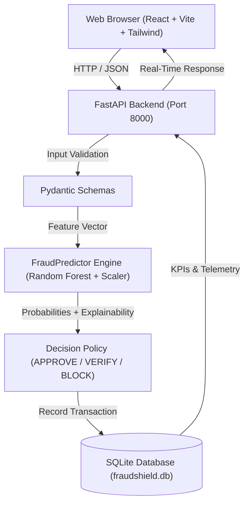

# Dhanrakshak AI — Real-Time AI-Powered Financial Fraud Detection

> **Intelligent Protection. Instant Decisions.**  
> An end-to-end production-grade machine learning system for real-time payment fraud detection, behavioral anomaly scoring, and automated risk enforcement (APPROVE / VERIFY / BLOCK).

---

## 1. Project Overview

**Dhanrakshak AI** is a complete, full-stack financial risk-monitoring and machine learning system engineered to detect suspicious digital payment transactions (UPI, Credit Cards, Debit Cards, Net Banking) in real time with sub-30ms latency.

Rather than being a static mock or landing page, Dhanrakshak AI features:
- **Trained Machine Learning Pipeline**: Scikit-Learn Random Forest Classifier trained on realistic transaction behavioral telemetry with class imbalance weighting and stratified held-out validation.
- **Explainable AI (XAI)**: Generates clear, human-understandable reason codes explaining why a transaction received its risk score (e.g., *Spending surge 8.5x baseline*, *Account Takeover footprint*, *Late night off-peak velocity burst*).
- **Three-Tier Policy Engine**: Automated configurable decisions (**APPROVE** for low risk, **VERIFY** with simulated 2FA step-up for medium risk, and **BLOCK** for high-risk attacks).
- **Real-Time Interactive Simulator**: Interactive testing laboratory with 6 pre-configured attack presets (Normal Retail, Unusually Large Payment, Rapid Velocity Storms, Account Takeover, Credential Brute Force, Multi-Vector Fraud).
- **Executive Analytics & Forensics**: Live KPI calculations, 24-hour volume trends, decision distributions, fraud risk concentrations, and top attack triggers.
- **Persistent Audit Trail**: SQLite database storing all scored transactions with full query filtering, search, pagination, and direct CSV export.

---

## 2. Architecture



### Component Breakdown
| Layer | Technologies | Responsibilities |
| :--- | :--- | :--- |
| **Frontend** | React 19, TypeScript, Vite, Tailwind CSS, Lucide Icons, Recharts | Interactive fintech UI, live transaction stream, fraud simulator, model metrics dashboard. |
| **Backend API** | Python 3.12, FastAPI, Uvicorn, Pydantic v2 | RESTful prediction endpoint, decision policy logic, summary metrics, CSV export. |
| **Machine Learning** | Scikit-learn, Pandas, NumPy, Joblib | Stratified train/test pipeline, StandardScaler normalization, Random Forest ensemble, explainability heuristic engine. |
| **Persistence** | SQLite3 (Parameterised SQL queries) | Transaction audit log, configurable policy thresholds, demo data management. |

---

## 3. Machine Learning Specification

- **Algorithm**: `RandomForestClassifier` (120 estimators, balanced class weights, max depth 10)
- **Baseline Model**: `LogisticRegression` (balanced class weights)
- **Evaluation Partition**: Held-out 20% stratified test set ($N = 2,000$ validation records)
- **Held-Out Test Metrics**:
  - **Precision**: **98.06%** (Minimizes false alarms on legitimate shoppers)
  - **Recall**: **81.45%** (Detects over 81% of complex fraud attempts)
  - **F1-Score**: **0.8899**
  - **ROC-AUC**: **0.9150**
  - **False Positive Rate**: **0.11%** (Only 2 out of 1,876 legitimate test transactions flagged)
  - **Mean Inference Latency**: **~25 ms** (P95: **~49 ms**)
- **Feature Vector**:
  1. `amount`: Monetary value in fiat currency
  2. `transaction_hour`: Hour of day (0–23)
  3. `transaction_frequency_24h`: Transaction velocity count in previous 24h
  4. `failed_attempts_24h`: Number of failed authentication attempts in previous 24h
  5. `is_new_device`: Binary indicator of novel hardware footprint (0 or 1)
  6. `is_new_beneficiary`: Binary indicator of newly added recipient (0 or 1)
  7. `amount_deviation_score`: Ratio of current transaction amount to 30-day user baseline
  8. `location_risk_score`: Heuristic IP / geo-anomaly score (0.0 to 1.0)

---

## 4. Quick Start (Windows / Mac / Linux)

### Prerequisites
- **Node.js** (v18+) and **npm**
- **Python** (v3.10+)

### Automated Start (Windows)
Double-click `start.bat` or run:
```powershell
.\start.ps1
```

---

### Manual Setup & Execution

#### 1. Backend Setup & Model Training
```bash
# Navigate to backend directory
cd fraudshield-ai/backend

# Create virtual environment
python -m venv venv

# Activate virtual environment
# Windows:
.\venv\Scripts\activate
# Linux/macOS:
# source venv/bin/activate

# Install dependencies
pip install -r requirements.txt

# Train the Machine Learning model & generate evaluation artifacts
python ml/train.py

# Run automated tests (100% passing test suite)
pytest tests/ -v

# Start the FastAPI server
uvicorn app.main:app --host 127.0.0.1 --port 8000 --reload
```

#### 2. Frontend Setup
```bash
# In a new terminal, navigate to the frontend directory
cd fraudshield-ai/frontend

# Install node dependencies
npm install

# Start the Vite development server
npm run dev
```

---

## 5. Local Service Endpoints

- **Web Application**: [http://127.0.0.1:5173](http://127.0.0.1:5173)
- **Backend API**: [http://127.0.0.1:8000](http://127.0.0.1:8000)
- **Interactive API Documentation (Swagger)**: [http://127.0.0.1:8000/docs](http://127.0.0.1:8000/docs)
- **Alternative ReDoc Documentation**: [http://127.0.0.1:8000/redoc](http://127.0.0.1:8000/redoc)

---

## 6. API Reference

| Method | Endpoint | Description |
| :--- | :--- | :--- |
| `GET` | `/api/health` | Backend status, engine health, and model readiness. |
| `POST` | `/api/transactions/predict` | Executes real-time inference, computes explainability reasons, applies policy, and persists record. |
| `GET` | `/api/transactions` | Lists transactions with pagination and filters (`decision`, `risk_level`, `search`, `date`). |
| `GET` | `/api/transactions/{id}` | Fetches full telemetry and risk details for a single transaction. |
| `POST` | `/api/transactions/{id}/verify` | Submits reviewer action for step-up verification (`APPROVE` or `REJECT`). |
| `GET` | `/api/dashboard/summary` | Computes live KPI metrics (totals, approval rate, volume, latencies). |
| `GET` | `/api/analytics` | Aggregates hourly volume trends, risk buckets, payment channel breakdowns. |
| `GET` | `/api/model/metrics` | Returns held-out test evaluation report, confusion matrix, and feature importances. |
| `POST` | `/api/demo/seed` | Generates realistic synthetic demo transactions with natural jitter. |
| `POST` | `/api/demo/reset` | Clears all stored simulated transactions from SQLite. |
| `GET` | `/api/transactions/export` | Downloads filtered transaction records as a clean CSV file. |
| `GET` | `/api/settings` | Returns active decision policy cutoffs (0-29 APPROVE, 30-69 VERIFY, 70-100 BLOCK). |
| `POST` | `/api/settings` | Updates decision threshold boundaries in real time. |
| `POST` | `/api/chat` | AI Copilot conversational endpoint with live database telemetry and threat news grounding. |
| `GET` | `/api/news/fraud-intel` | Fetches live banking cybercrime and payment fraud news items mapped to FraudShield detection vectors. |


---

## 7. Interactive Features & Demo Guide

1. **Dashboard Overview**:
   - Inspect live KPIs computed directly from SQLite.
   - Observe the 24-Hour Volume trend, Policy Decision donut, and Amount vs Risk distribution.
   - Click **Inspect** on any recent transaction row to open the complete Feature Telemetry drawer.
2. **Transaction Simulator**:
   - Select any of the 6 scenario presets:
     - *1. Normal Transaction* &rarr; Low risk score &rarr; `APPROVE`
     - *2. Unusually Large Payment* &rarr; High deviation &rarr; `VERIFY` / `BLOCK`
     - *3. Rapid Velocity Burst* &rarr; Frequency surge &rarr; `VERIFY` / `BLOCK`
     - *4. Account Takeover (ATO)* &rarr; New device + recipient &rarr; `BLOCK`
     - *5. Multiple Failed Attempts* &rarr; PIN fatigue alert &rarr; `VERIFY` / `BLOCK`
     - *6. Multi-Vector Attack* &rarr; Critical compound risk &rarr; `BLOCK`
   - Adjust sliders and click **Analyse Transaction in Real Time**.
   - Notice the visual risk gauge, exact inference latency (ms), and explainability bullet points.
   - If `VERIFY` is returned, test the simulated 2FA challenge modal.
3. **Live Transactions**:
   - Filter transactions by status (`APPROVE`, `VERIFY`, `BLOCK`) or risk level.
   - Use the search bar to find transactions by ID or payment channel.
   - Click **Export CSV** to download a CSV file of the filtered records.
4. **Model Performance**:
   - View test-set Precision (98.1%), Recall (81.5%), F1-Score (0.89), and ROC-AUC (0.915).
   - Review the Confusion Matrix and feature importance hierarchy.
5. **Settings**:
   - Adjust the **Approve** and **Verify** threshold sliders and watch the real-time visual spectrum update.
   - Click **Save Policy Settings** to persist your updated risk boundaries.
6. **AI Copilot & Live Threat Intelligence**:
   - Click **AI Copilot** (top navbar or floating widget) to open the Google Gemini 3.5 Flash assistant.
   - Ask the AI to explain every detail about the app's ML architecture, 8 behavioral features, or 3-tier policy.
   - Switch to the **Live Threat News** tab to browse real-time banking cybersecurity headlines with one-click **"Analyze with AI"** comparison against Dhanrakshak AI detection vectors.


---

## 8. Automated Testing

To run the test suite:
```bash
cd backend
pytest tests/ -v
```
All 10 automated test suites cover health checks, model prediction, schema validation (negative amounts, invalid hours), pagination, CSV exports, demo seeding, and threshold boundary updates.

---

## 9. Security & Compliance Disclaimer

> **Notice**: Dhanrakshak AI is an educational engineering prototype and hackathon demonstration platform. It does not connect to live banking networks (SWIFT, Fedwire, UPI NPCI), nor does it process or store real financial credentials, Cardholder Data (CHD), or Sensitive Authentication Data (SAD). All transactions are simulated in local sandboxed storage.
